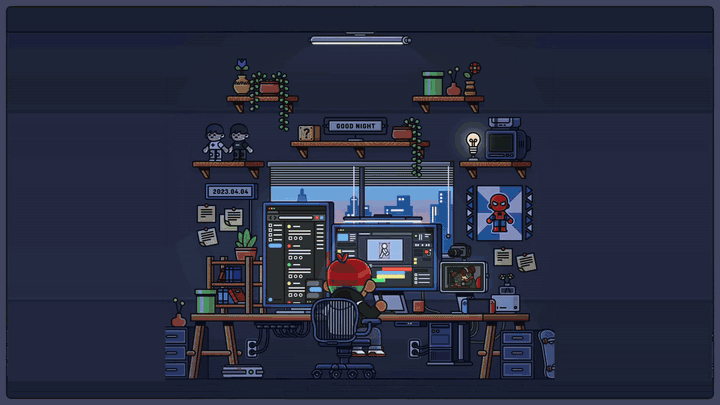
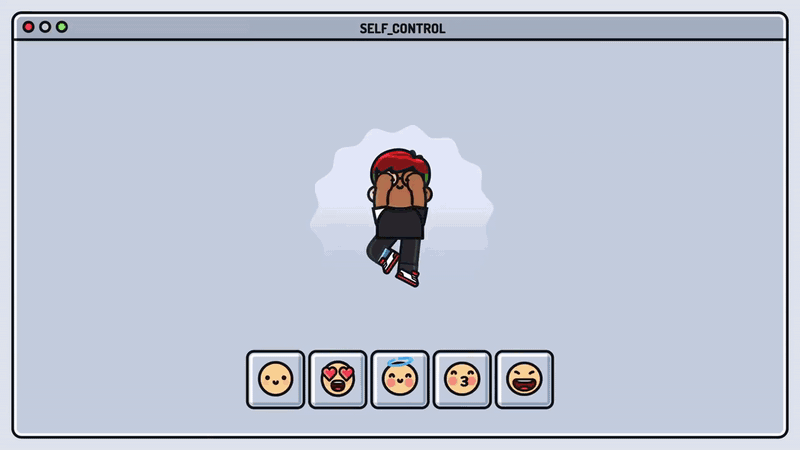
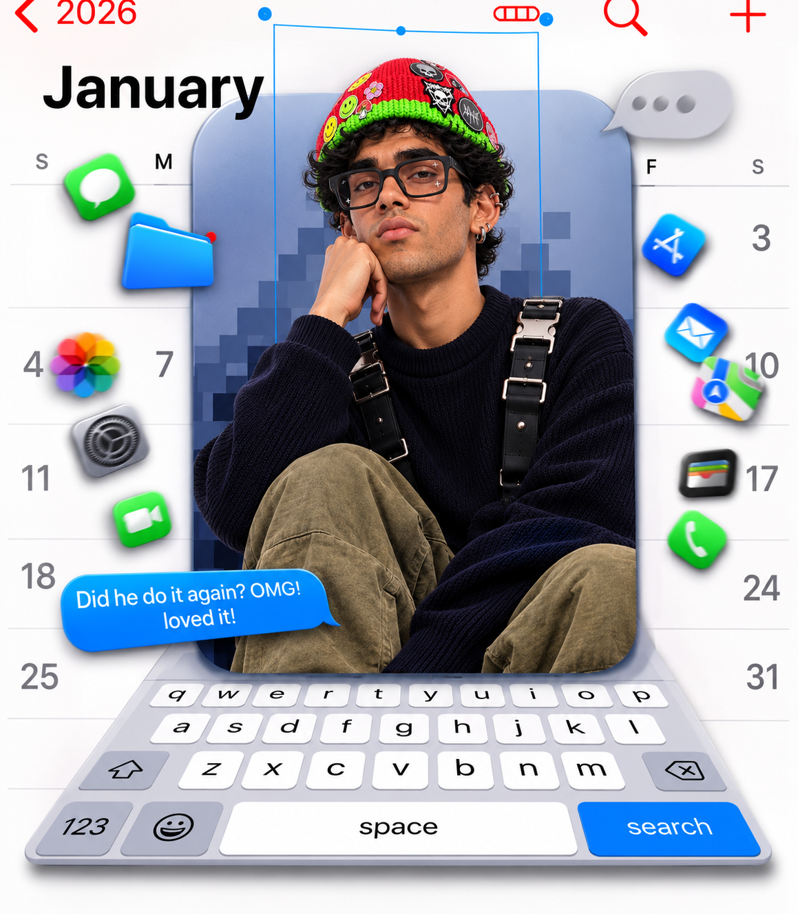

<picture>
  <source media="(prefers-color-scheme: dark)" srcset="https://readme-typing-svg.demolab.com/?font=Cinzel&weight=700&size=42&letterSpacing=0.08em&duration=2200&pause=99999&repeat=false&center=true&vCenter=true&width=700&height=70&lines=Hi%2C+I%27m+Aaditya+Jaiswar&color=FFFFFF">
  
</picture>
<picture>
  <source media="(prefers-color-scheme: dark)" srcset="https://readme-typing-svg.demolab.com/?font=Cinzel&weight=500&size=17&letterSpacing=0.3em&duration=1800&pause=1400&center=true&vCenter=true&width=750&height=40&lines=SOFTWARE+DEVELOPMENT+ENGINEER;FULL-STACK+DEVELOPER;AI+%26+LLM+ENGINEER;BACKEND+%26+API+DEVELOPER;CLOUD+%26+DEVOPS+ENGINEER;MOBILE+APP+DEVELOPER;IOT+DEVELOPER&color=9CA3AF">
  
</picture>

---

I build AI agents, backend systems, and full-stack products: from LLM fine-tuning and agent debugging tools to quantum ML on satellite imagery. Currently an **SDE Intern at Periscope Technologies**.

### Tech Stack

<b>Languages</b>
 
   
  

<b>Backend</b>
 
     
  

<b>AI / ML</b>
 
    
  

<b>GenAI & Agents</b>
 
   
  

<b>Frontend & Mobile</b>
 
      
  

<b>Databases</b>
 
      
  

<b>Cloud & DevOps</b>
 
        
  

<b>Testing & Automation</b>
 
  
  

 

  

